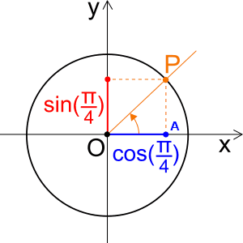

# Funzioni

Si dice che una quantità $y$ è funzione di una quantità $x$ quando data $x$ si ricava $y$ in maniera univoca, cioè ad $x$ corrisponde uno e uno solo valore di $y$.

L'insieme $x$ si chiama dominio della funzione

Si scrive: $f: x -> y$

Il numero $f(x)$ (ovvero $y$) si chiama anche immagine di x tramite $f$ e i suoi possibili valori sono l'insieme immagine o immagine di $f$.

## Funzione potenza

$x -> x^\alpha$

Dominio: $R$ se $\alpha \in N-0$ (positivo intero)

$R-0$ se $a \in Z<0$ (negativo intero)

$R^{>0}$ se $\alpha \in R-Z$ (gli altri casi)

## Funzioni trigonometriche

Voglio trovare un modo di calcolare l'angolo $AOP$. Dico che l'ampiezza di $AOP$ è la lunghezza dell'arco $x$ (misura in radianti).

Definizione: $cos(x)$, $sin(x)$ = le cordinate $(x, y)$ del punto $P$

$sin$ e $cos$ $\in [-1; +1]$

$sin^2x +cos^2x$ = 1

$tan(x) = \frac{sin(x)}{cos(x)}$

